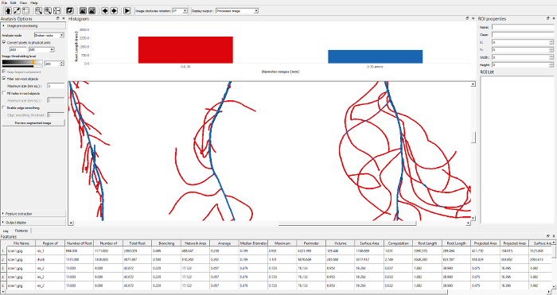

#  RhizoVision Explorer

RhizoVision Explorer is free and open-source software developed for estimating root traits from images acquired from a flatbed scanner or camera. Root images are expected to have a high contrast of roots with the background, homogenous lighting, and minimal overlapping of roots. The software is built in C++ for speed and stability, using QT for the graphical user interface and OpenCV for image processing. Traits extracted by RhizoVision Explorer have been extensively validated using a physical copper wire ground truth image set, thousands of simulated roots, and comparisons with other image analysis software. The default “Broken Roots” mode is meant for roots washed out from soil cores or pots that are disconnected and provides length, volume, branching frequency, among other features, with the ability to bin measurements based on diameter thresholds. The “Whole Root” mode extracts additional root system architecture features of more intact root systems, especially excavated root crowns or rhizoboxes, such as the convex hull, angles, and holes. The software supports multiple regions of interest, batch mode, and user-defined export of processed images with overlaid features for use in reports.

#### Downloading
The software binary can be downloaded [here](https://doi.org/10.5281/zenodo.3747697).

The source code repository is located [here](https://github.com/rootphenomicslab/RhizoVisionExplorer).

#### Running the Program

The program opens a GUI where we specify the location of root images and output location to save the processed images and the extracted features. We can change the options that suit the input images and click the start button to start extracting the feature traits from the root images.



#### Pre-requisites for Running the Program

The program supports x86_64 processors and Apple Silicon Macs. If an x86_64 CPU supports Intel AVX 2.0, the program runs faster for feature extraction. Apple Silicon builds disable the x86-specific AVX flags.

#### Compiling the Source

The source code is compiled with CMake 3.28 or newer and a C++17 compiler (Microsoft Visual Studio on Windows, GCC/Clang on Linux, or Apple Clang on macOS). The program depends on Qt 6.9 (including Charts), OpenCV 4.11 or above and [cvutil](https://github.com/rootphenomicslab/cvutil) 2.5.0 libraries for compiling the source.

##### Building on macOS

Install the Xcode Command Line Tools (`xcode-select --install`) and the dependencies above, all built for the same architecture (`arm64` on Apple Silicon or `x86_64` on Intel). From the repository root:

```bash
# Installation prefix containing Qt, OpenCV, and cvutil.
export RVE_DEPS_PREFIX="/path/to/dependency/prefix"
cmake -S . -B build/macos \
  -DCMAKE_BUILD_TYPE=Release \
  -DCMAKE_PREFIX_PATH="$RVE_DEPS_PREFIX" \
  -DCMAKE_INSTALL_PREFIX="$PWD/build/macos-install" \
  -DENABLE_AVX512=OFF -DENABLE_AVX2_FMA=OFF
cmake --build build/macos --parallel
cmake --install build/macos
codesign --force --deep --sign - build/macos-install/RhizoVisionExplorer.app
open build/macos-install/RhizoVisionExplorer.app
```

For a separate cvutil installation, append `;/path/to/cvutil/prefix` to `CMAKE_PREFIX_PATH`. The app and CLI (`rv`) are installed in `build/macos-install`; re-signing is needed after installation changes library paths.

Qt's `macdeployqt` is required for a self-contained app. To create a DMG after building, run `(cd build/macos && cpack -G DragNDrop -C Release)`. Builds use ad-hoc signing and are not notarized.

#### Example Usage from Command Line

RhizoVision Explorer supports command line interface (CLI) for batch processing and automation. The CLI provides extensive configuration options for root analysis, region of interest specification, and output customization. You can process single images or entire directories with various analysis parameters.

For detailed CLI usage examples and comprehensive command reference, see [Example Usage](example_usage.md).


#### Copyright and License

Copyright (C) 2025, Oak Ridge National Laboratory  
Copyright (C) 2021, Anand Seethepalli and Larry York  
Copyright (C) 2020, Courtesy of Noble Research Institute, LLC

**RhizoVision Explorer**

RhizoVision Explorer is free software: you can redistribute it and/or modify it under the terms of the GNU General Public License as published by the Free Software Foundation, either version 3 of the License, or (at your option) any later version.

RhizoVision Explorer is distributed in the hope that it will be useful, but WITHOUT ANY WARRANTY; without even the implied warranty of MERCHANTABILITY or FITNESS FOR A PARTICULAR PURPOSE.  See the GNU General Public License for more details.

You should have received a copy of the GNU General Public License along with RhizoVision Explorer; see the file COPYING.  If not, see <https://www.gnu.org/licenses/>.

#### Citing
Please use the following citation when using the software.

> Anand Seethepalli, & Larry York. RhizoVision Explorer - Interactive software for generalized root image analysis designed for everyone (Version 2.0.3). Zenodo. https://doi.org/10.5281/zenodo.3747697

#### Authors

Please send any comments/suggestions/improvements for the program to the authors:

Anand Seethepalli  
seethepallia@ornl.gov

Larry York  
yorklm@ornl.gov
